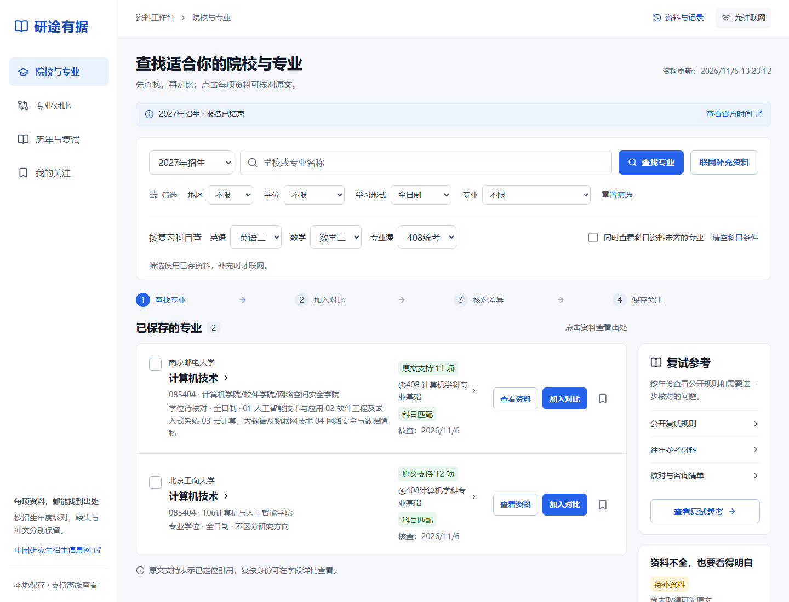
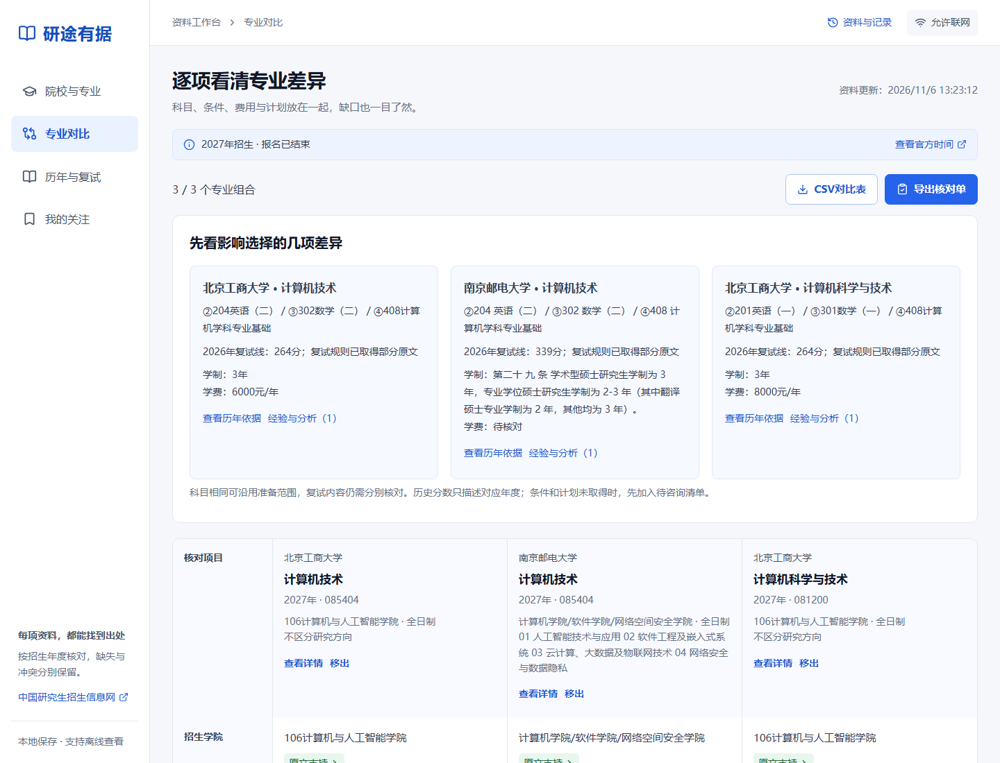
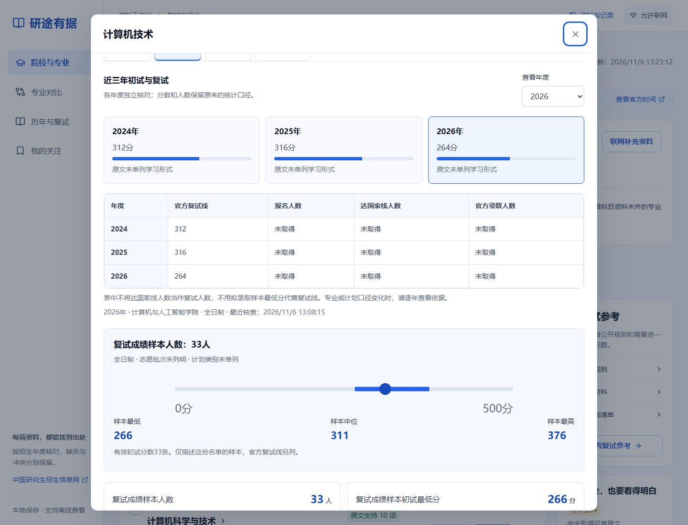

# 研途有据 · Yantu Evidence

用元宝搜索查找招生公告和附件，把专业科目、历年情况与原文依据放到同一份择校对照里。

这是一个本地运行的考研资料工作台：按名称和复习科目查找专业，最多比较三个专业组合；需要确认一个数字时，可以展开来源、年份和原文位置。资料缺失、口径不明或来源冲突会保留在页面中。

默认目标为 **2027年招生，对应2026年底初试**。仓库预置的是截至2026年11月6日整理的公开材料摘录，后续公告需要主动更新核对。



## 可以做什么

- 按学校、专业名称、英语一/二、数学一/二、408或自命题筛选；科目没有正式材料支持时，不显示为匹配。
- 区分学院、方向、学位类型和学习形式，保存候选、关注与逐字段核对记录。
- 查看2024—2026年的复试线、官方人数口径、成绩样本和复试规则，回查对应原文。
- 将最多三个专业放入对比，导出包含来源、核查时间和资料缺口的HTML核对单或CSV。
- 主动查找招生材料、复试参考与公开经验；官方规则、历史材料和个人经历分开保存。
- 在本地服务运行、外部网络不可用时，查看已有资料、保存记录及导出报告。页面地址保留筛选、详情与比较状态。



## 快速开始

需要 **Node.js 24.14.0或更新版本、Python 3及npm**。Python依赖见 [requirements.txt](requirements.txt)，Chromium只用于可选的浏览器验收。

```powershell
git clone https://github.com/Hyone-soul/yantu-evidence.git
cd yantu-evidence
npm ci
python -m pip install -r requirements.txt
Copy-Item .env.example .env.local
npm run doctor
npm run build
npm start
```

打开 **http://127.0.0.1:4327/**。服务只监听本机，首次启动会建立`data/kaoyan.sqlite`并载入公开核验摘录，无需提供API密钥即可浏览、比较和导出。macOS/Linux复制配置时，将`Copy-Item`替换为`cp`。

Windows也可以在安装Python依赖并复制配置后，双击`启动研途有据.cmd`。

开发模式：

```powershell
npm run dev
```

开发界面位于http://127.0.0.1:5327/，API位于http://127.0.0.1:4327/。生产使用应先运行`npm run build`，然后`npm start`。

## 配置联网补充

`.env.example`默认设置`APP_OFFLINE=1`，便于先使用已存资料。联网补充需要在**本机的`.env.local`**中配置服务端凭据，将`APP_OFFLINE`改为`0`并重启。

| 变量 | 用途 |
| --- | --- |
| `TENCENTCLOUD_SECRET_ID` / `TENCENTCLOUD_SECRET_KEY` | 元宝搜索的腾讯云凭据 |
| `LLM_BASE_URL` / `LLM_API_KEY` | 支持Chat Completions的模型服务地址及密钥，地址通常以`/v1`结尾 |
| `LLM_MODEL` | 模型名称，按实际开通的服务设置；当前默认值见配置示例 |
| `APP_HTTP_PROXY` | 可选HTTP代理；示例中的空值表示直连，使用本机代理时可填`http://127.0.0.1:7897` |
| `APP_OFFLINE` | `1`禁止外部任务；`0`允许主动发起联网任务 |
| `APP_DB_PATH` | SQLite路径，默认`data/kaoyan.sqlite` |
| `PORT` / `PYTHON_BIN` | 服务端端口及Python命令，默认`4327` / `python` |
| `APP_CREDENTIALS_DIR` | 可选的外部凭据文件目录；支持已有的`元宝搜索.txt`与`大模型使用.txt`格式，默认工程父目录 |

密钥只由服务端读取，不要放入`VITE_*`变量、网页代码或提交到Git。无需设置`.env.local`以外的全局配置。

输入名称、切换筛选、翻页和刷新不会自动发出搜索或模型请求。用户明确点击“联网补充资料”或更新按钮后才创建任务；实际费用以对应服务的账户计费为准。重新打开旧任务只读取已存记录，不会自动重试。

## 元宝搜索怎样参与

元宝搜索负责发现相关公告、页面和附件入口。Node服务取得原文后，Python提取HTML、文本PDF和Excel；结构化表格按表头与行定位，模型从编号片段中辅助提取和解释，服务端继续检查引用、年度、适用对象及科目代码。


来源记录区分搜索发现、预置入口和人工补充。搜索摘要不等于取得原文，模型整理也不等于招生单位确认。网页或附件无法取得时保存原因，不补造字段。

任务限额固定为：最多三个专业组合、18次搜索、6次模型请求、12份去重文档；单份8MiB、累计40MiB、下载超时20秒。同时只执行一个联网任务，重试计入限额。重启会将未完成任务标记为中断。

下载逐跳检查院校域名、DNS、目标IP和重定向，阻止本机及内网地址，保留TLS证书校验。公开经验网站使用独立登记范围，不扩大院校资料白名单。

## 数据范围与口径

预置材料包含21条专业身份记录、南邮和北工商的12条年度记录；记录并不表示所有字段已经齐全。数据只在空数据库中载入，不覆盖自己的资料。



- 达国家线人数、进入复试人数和拟录取人数分别记录。
- 复试成绩单仅提供相应名单样本，不视为录取名单；样本最低分与官方复试线分别展示。
- 一志愿、调剂、推免、专项及学习形式按原文区分。完整人群不足时不计算淘汰率或报录比。
- 历史规则带年份，不能替代当年规则；个人经历与学校整体就业介绍不能改写成专业招生结论。
- 原文支持表示已有引用位置；系统核对与本人确认分别标注，不代表专家审定。

仓库只附公开院校材料的必要摘录和汇总，不包含完整文档、考生名单、个人经历原文、用户核对历史或本机任务数据库。详见 [预置资料说明](research/README.md)。正式报考条件与招生安排以招生单位当年公告为准。

## 验证

以下命令不调用付费搜索或模型接口：

```powershell
npm run doctor
npm test
npm run build
npm run verify:api
```

API验收使用4328端口、临时数据库和强制离线模式，覆盖持久化、导出、引用修订校验及中断恢复。

2026年11月9日发布核对：独立安装依赖、68项测试、类型检查、生产构建、15项API验收及18项桌面/手机验收通过。检查使用隔离数据，付费搜索和模型请求为0。

可选的桌面和390×844手机验收：

```powershell
npx playwright install chromium
npm run verify:ui
```

浏览器验收使用4330端口及隔离数据库；已有本地资料时取副本，否则从仓库预置摘录启动。检查筛选、页签、三个专业对比、原文跳转、导出、刷新恢复和键盘操作。验收输出位于`artifacts/`，不会提交到仓库。

## 项目结构

```text
src/          React资料工作台
server/       Express API、搜索签名、下载、事实校验和SQLite
shared/       专业身份、字段与科目匹配类型
scripts/      文档提取、开发启动、依赖及验收命令
tests/        年度、口径、引用、解析与下载回归测试
research/     公开核验摘录及来源说明
docs/images/  实际界面截图
```

技术栈：React、TypeScript、Vite、Express、Node内置SQLite，以及Python的BeautifulSoup、PyMuPDF、pdfplumber、openpyxl和xlrd。

这是本地单用户工具，没有登录、计费、录取概率预测或公网多用户权限隔离。扫描PDF、旧式Word、验证码和复杂动态页面可能需要人工继续核对。

## 参与改进

欢迎提交资料口径、解析错误或使用问题。反馈数据问题时请提供学校、学院、专业、招生年度、原文链接及具体位置，避免上传考生个人信息或服务密钥。修改代码后运行`npm test`、`npm run build`和相关验收，再提交Pull Request。

## 许可证

项目代码采用 [MIT License](LICENSE)，版权归属为`2026 Hyone-soul`。公开资料摘录的权利归原发布单位，来源链接保留在数据中；代码许可证不转授这些材料的版权。
